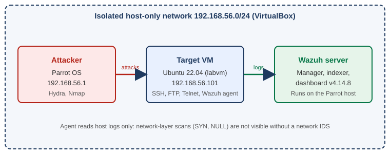

# SOC Home Lab: Purple Team

A hands-on detection lab where I attack my own systems from Parrot OS, then detect, triage and document each attack in **Wazuh** (SIEM/XDR), mapping every finding to **MITRE ATT&CK**.

**Result so far:** 4 attack-and-detect cycles completed, 2 custom detection rules written, deployed and live-verified, 2 detection gaps documented with recommended fixes.

## Architecture



| Component | Details |
|---|---|
| Attacker | Parrot OS, `192.168.56.1` |
| Target | Ubuntu 22.04 VM (`labvm`, `192.168.56.101`) with Wazuh agent v4.14.8 |
| SIEM / XDR | Wazuh manager, indexer and dashboard v4.14.8 (on the Parrot host) |
| Network | Isolated VirtualBox host-only network `192.168.56.0/24` |
| Attack tools | Hydra 9.5, Nmap 7.95 |

## Attack and detection writeups

| # | Technique | ATT&CK | Outcome | Writeup |
|---|---|---|---|---|
| 1 | SSH brute force | T1110, T1110.001 | Detected. Rules 5710, 5712 and 40112 (level 12, success after failures) fired | [Read](wazuh-lab/attack-detect-writeups/01-ssh-brute-force-T1110.md) |
| 2 | Network service scan | T1046 | Partial. Only the `-sV` scan left log traces; SYN and NULL scans were invisible to a host agent (gap documented) | [Read](wazuh-lab/attack-detect-writeups/02-network-scan-T1046.md) |
| 3 | Local account persistence and privilege escalation | T1136.001, T1098 | Detected. Rules 5901, 5902 and custom rule 100100 (written by me to close a gap) | [Read](wazuh-lab/attack-detect-writeups/03-local-account-persistence-T1136.md) |
| 4 | Log tampering / anti-forensics | T1070.002, T1070.003 | Mostly detected. `auth.log` tampering confirmed live via custom rule 100101; shell history clearing left no trace (confirmed gap, no `auditd` on this host) | [Read](wazuh-lab/attack-detect-writeups/04-log-tampering-T1070.md) |

## Key findings

- **Same attack, different alerts.** A brute force against a non-existent user only reaches rule 5712 (level 10). Against a real account with a weak password it escalates to rule 40112 (level 12), because the compromise is confirmed.
- **No alert does not mean the agent failed.** A log-based agent cannot see SYN or NULL scans because they never write a log line. Detecting them needs a network IDS (Suricata or Snort).
- **Default coverage has holes.** Wazuh alerted on account creation but had no dedicated alert for `usermod -aG sudo`, the actual privilege escalation. I wrote rule 100100 to close it and verified it live.
- **FIM ignores `.log` files by default.** `/var/log` has to be explicitly added to `<syscheck>` *and* the global `.log$` ignore pattern has to be narrowed, or log-tampering attacks are invisible to Wazuh from the start.
- **Without `auditd`, command-level anti-forensics is undetectable.** `history -c` touches no monitored file and writes no log line — a log-based SIEM alone cannot see it.

## Detection rules

| Rule ID | Description | MITRE | Used in |
|---|---|---|---|
| [100100](wazuh-lab/detection-rules/100100-sudo-group-privilege-escalation.xml) | User added to sudo group (privilege escalation), level 12 | T1098 (T1098.007 is more precise but is not in the Wazuh 4.14.8 MITRE database) | [Writeup 3](wazuh-lab/attack-detect-writeups/03-local-account-persistence-T1136.md) |
| [100101](wazuh-lab/detection-rules/100101-auth-log-size-drop.xml) | `auth.log` size changes (possible log tampering), level 12 — live-verified | T1070.002 | [Writeup 4](wazuh-lab/attack-detect-writeups/04-log-tampering-T1070.md) |

## Cloud SIEM module (Elastic)

A second, separate module covers the same SSH brute-force scenario against a **cloud-hosted SIEM** (Elastic Security on Elastic Cloud) instead of the self-hosted Wazuh stack above — log shipping via Elastic Agent, KQL querying in Discover, and a custom detection rule. See [`elastic-cloud/README.md`](elastic-cloud/README.md) for the full writeup.

## Skills demonstrated

SIEM alert triage, log analysis (`auth.log`), File Integrity Monitoring, detection engineering (custom Wazuh rules, `wazuh-logtest`), MITRE ATT&CK mapping, true/false positive analysis, incident-style reporting with response recommendations.

## Repository layout

```
wazuh-lab/
├── architecture/            lab diagram
├── attack-detect-writeups/  one markdown file per attack
├── detection-rules/         custom Wazuh rules
└── screenshots/             alert evidence

elastic-cloud/
├── README.md                cloud SIEM module: Elastic Cloud + Elastic Agent + detection rule
├── screenshots/
└── detection-rule.ndjson    exported custom detection rule
```

## Scope and safety

All attacks target virtual machines I own, on an isolated host-only network with no route to the internet or to other devices. Credentials shown in the writeups are throwaway lab credentials. No real systems, accounts or IP addresses are included.

## Author

**Kartik Nagose**, entry-level SOC analyst candidate
[LinkedIn](https://www.linkedin.com/in/kartik-nagose-852b543a4) | [GitHub](https://github.com/kartiknagose) | kartiknagose1@gmail.com
