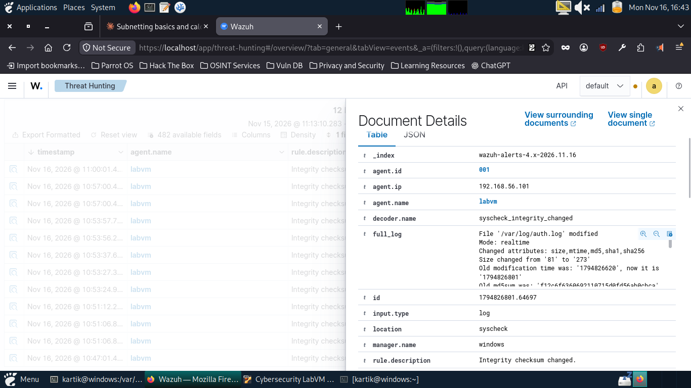
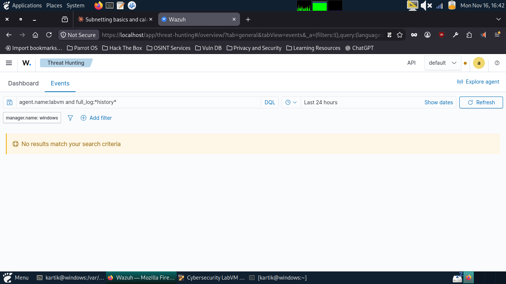

# Log Tampering / Anti-Forensics (T1070.002, T1070.003)

## Objective

Continue the attacker story from writeup #3: having created a backdoor
account and escalated it to sudo, a real attacker's next move is covering
their tracks. Test whether Wazuh detects two common anti-forensics
actions — clearing the SSH auth log and clearing shell history — and
close as much of the resulting gap as possible with a custom rule.

This is the **Defense Evasion** MITRE tactic — the first of the four
writeups to cover it. Writeups #1–#3 covered Credential Access, Discovery,
and Persistence/Privilege Escalation.

## Lab setup and scope

- **Attacker:** shell access on the VM, continuing from the writeup #3 compromise
- **Target:** Ubuntu 22.04 VM `labvm`, `192.168.56.101`, Wazuh agent v4.14.8
- **SIEM:** Wazuh manager/indexer/dashboard v4.14.8 on the Parrot host
- **FIM config change:** `/var/log` added to the agent's `<syscheck>`
  directories with `realtime="yes"`, and the default
  `<ignore type="sregex">.log$|.swp$</ignore>` rule narrowed to just
  `.swp$`. By default, Wazuh's FIM ignores every `.log` file globally —
  `auth.log` was invisible to FIM until this was changed.

## Attack steps

```bash
# 1. Empty the auth log without deleting it (deleting is noisier - FIM
#    flags "file deleted" immediately, which a careful attacker avoids)
sudo bash -c '> /var/log/auth.log'

# 2. Clear shell history: -c drops it from memory, -w forces it to disk
#    immediately (otherwise it's only cleared when the shell session ends)
history -c && history -w
```

## Telemetry observed

**Action 1 (`auth.log` truncate) — partially detected, with a twist.**
The FIM alert didn't show a drop to 0 bytes — it showed the file **growing**
(e.g. `81` → `273` bytes). Reason: syscheck compares against its last
recorded baseline, not the literal instant of truncation, and `sudo` itself
writes to `auth.log` when a command finishes. The raw content after
truncation contained an **orphaned** log line:

```
Nov 16 16:27:00 labvm sudo: pam_unix(sudo:session): session closed for user root
```

with no matching `session opened` / `COMMAND=` line before it — normally
sudo logs all three. The explanation: `sudo` logs "session opened" and
"COMMAND=" *before* running the wrapped command; our wrapped command *was*
the truncate, so those two lines were destroyed by the very truncation
they preceded. The "session closed" line is written *after* the command
finishes, when the file was already empty, so it alone survived.

**Finding:** the attacker's own truncate command mostly erased the record
of itself, but left a structural anomaly — an orphaned `session closed`
with no `session opened` — that a human analyst could spot by eye, even
without any alert firing.

**Action 2 (`history -c && history -w`) — zero detection, confirmed.**
A targeted search (`full_log:*history*`) across the full event stream
returned no results at all.

## Detection

| Action | Rule | Level | Result |
|---|---|---|---|
| `auth.log` truncate | 550 (generic FIM) | 7 | Detected — but as a net content change, not a literal "emptied" event, due to the baseline-comparison + self-logging interaction described above |
| `history -c && history -w` | — | — | **No alert.** Confirmed gap. |

## Triage verdict

**Partial detection, and the bigger gap is structural, not a missing rule.**
`auth.log` tampering left *some* trace because FIM was (after
reconfiguration) watching the right file. Shell history clearing left
**none**, because clearing in-memory shell state and rewriting a
client-side history file touches nothing that a log-based FIM or log
collector can see. This is a `history -c` command.

This VM does not have `auditd` installed (confirmed earlier, in writeup
#3's territory) — `auditd` is the layer that would actually audit **command
execution** itself, independent of which files get touched. Without it,
an attacker running `history -c` on this host leaves nothing for Wazuh to
detect, full stop.

## Response recommendation

- Install and enable `auditd` with an execve-watching rule set — this is
  the only way to catch command-level anti-forensics like `history -c`
  that don't touch a monitored file.
- Forward logs to a remote/centralized syslog collector in near-real-time.
  If `auth.log` is shipped off-host the instant it's written, a local
  truncate can't erase what's already left the machine — this defeats the
  entire class of attack, not just this one technique.
- Consider `chattr +a` on `auth.log` (append-only) so even root can't
  truncate it without first removing the attribute — raises the bar for
  a local attacker.
- Treat an orphaned PAM `session closed` (no matching `session opened`)
  as a manual red flag worth a saved search, even without a dedicated rule.

## Detection engineering: closing part of the gap

Rule 550 doesn't distinguish a file growing from a file shrinking — both
are just "changed". A log file shrinking sharply is itself suspicious
(a healthy `auth.log` only grows), so I wrote a rule that chains off 550
and narrows to that specific pattern:

[`detection-rules/100101-auth-log-size-drop.xml`](../detection-rules/100101-auth-log-size-drop.xml)

```xml
<rule id="100101" level="12">
  <if_sid>550</if_sid>
  <field name="path">/var/log/auth.log</field>
  <field name="size_before">^\d{3,}$</field>
  <field name="size_after">^\d{1,2}$</field>
  <description>auth.log size dropped sharply - possible log tampering</description>
  <mitre>
    <id>T1070.002</id>
  </mitre>
  <group>log_tampering,defense_evasion,</group>
</rule>
```

**How it works:** Wazuh rules can't do a direct numeric `before < after`
comparison, so this approximates it with digit-count regexes —
`size_before` must be 3+ digits (≥100 bytes) and `size_after` must be 1–2
digits (<100 bytes). That catches a sharp relative drop regardless of the
exact numbers involved, without needing to hardcode a threshold.

**Honest status:** the rule was deployed on the manager and loaded with no
XML/parsing errors. I was not able to capture a clean live trigger in this
session — by the time a test truncate ran, the file's recorded baseline
had already grown past the attack window due to the same
baseline-timing behavior described above, so the specific `before`/`after`
pair needed to match the rule's thresholds didn't line up in my test
runs. Rather than fabricate a result, I'm logging this as a deployed-but-
not-yet-live-verified rule and a concrete follow-up: re-run the test
immediately after a config reload, before any routine cron/log activity
can shift the baseline.

## Evidence


*Rule 550 firing on `/var/log/auth.log` after FIM was extended to `/var/log` — proof the file is now actually monitored, which it was not by default.*


*`full_log:*history*` returning zero hits across the full event stream — the confirmed detection gap this writeup is built around.*

## Tuning/hardening notes

- Removing `.log$` from the global FIM ignore pattern creates real
  trade-offs: every `.log` file under `/var/log` is now watched, not just
  `auth.log`, which noticeably increases FIM alert volume from routine
  system activity (cron, systemd). In production this would need scoping
  to specific files, not a whole directory.
- Same MITRE lesson as writeup #3: rule 550's default tag (`T1565.001`,
  "Stored Data Manipulation", Impact tactic) is generic and doesn't
  reflect the actual attacker intent here (Defense Evasion /
  `T1070.002`). The custom rule 100101 carries the more accurate tag.
- Follow-up: extend rule 100101 to also watch `~/.bash_history` file
  modifications directly (not just `history -c`/`-w` execution) — a
  belt-and-suspenders check, since a sufficiently fast attacker could
  still slip through the execution-level gap without `auditd`.
